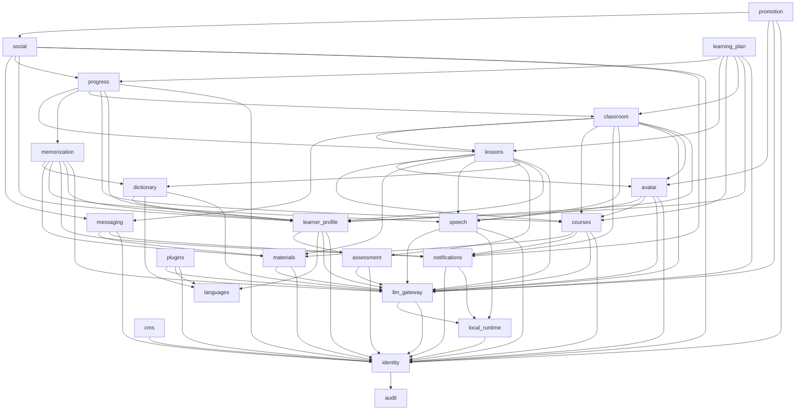

# SYS-01 — Карта модулей

| Поле | Значение |
|---|---|
| Статус | approved |
| Версия | 1.0 |
| Дата | 2026-10-11 |
| Автор | Claude (черновик) |
| Утвердил | пользователь, 2026-10-11 (PR #3) |
| Пункт(ы) BRD | все |
| Модуль | все |
| Зависимости | ADR-002, ADR-003, ADR-004, ADR-007, ADR-008, ADR-014, ADR-015 |
| Связанные ADR/SYS | ADR-005, ADR-006, ADR-009, ADR-013; SYS-02, SYS-04, SYS-05, SYS-06, SYS-08, SYS-09, SYS-12 |

## 1. Цель и область действия

- **Цель**: зафиксировать состав доменных модулей монолита, ответственность и границы каждого, владение данными (схема PostgreSQL, префикс Redis, бакеты, индексы, коллекции), публикуемые события, направление зависимостей между модулями и порядок слоёв для контракта `modules-dependency-order` import-linter (ADR-002, раздел 3.5), а также правила изменения карты. Карта — единственный источник истины о том, какой модуль существует, что ему принадлежит и от кого он вправе зависеть; по ней заполняются `app/modules/registry.py`, `.importlinter`, зоны ESLint фронтенда и спецификации модулей `_module.md`.
- **Область действия**: backend (`src/backend/py-monolyth/app/modules`, `app/core`), frontend (`src/frontend/src/features`, `src/frontend/src/app`), tests (архитектурные тесты `tests/architecture/`), CI (job `architecture`, job `docs`).
- **Действует с этапа**: 1.
- **Уточняет**: CLAUDE.md, разделы «Модульный монолит» и «Логичность разбиения»; SDD_plan.md, Приложение В (предварительная карта) и раздел 8, п. 6 (ревью разбиения); ADR-002 (раскладка модуля, `public/`, `ModuleDefinition`, контракты import-linter); ADR-004 (события, команды, роли монолита); ADR-007 и ADR-014 (владение бакетами, индексами и коллекциями); ADR-008 (`local_runtime`); ADR-015 (`classroom` и роль `media_agent`).

## 2. Термины

| Термин | Определение или ссылка |
|---|---|
| Модуль (bounded context) | [глоссарий](../../glossary.md), раздел 12 |
| Карта модулей | [глоссарий](../../glossary.md), раздел 12 |
| Shared kernel | [глоссарий](../../glossary.md), раздел 12 |
| Публичный API модуля | [глоссарий](../../glossary.md), раздел 12 |
| Граница модуля | [глоссарий](../../glossary.md), раздел 12 |
| Доменное событие, топик Kafka, transactional outbox, фоновое задание | [глоссарий](../../glossary.md), раздел 12 |
| Бакет | [глоссарий](../../glossary.md), раздел 12 |
| Персонаж платформы | [глоссарий](../../glossary.md), раздел 6 |
| Уведомление | [глоссарий](../../glossary.md), раздел 7; модуль-владелец — `notifications` (раздел 3 этой спецификации, решает OQ-49) |
| Слой модулей | Строка контракта `modules-dependency-order` import-linter (`type = layers`): набор модулей, которые не зависят друг от друга и могут импортировать `public` только модулей нижележащих строк. Введён этой спецификацией |
| Команда | Сообщение Kafka в топик заданий модуля-владельца `flt.<owner>.jobs.<job>.v<N>`, которым другой модуль просит владельца изменить его данные (ADR-004, раздел 3.1). В отличие от доменного события публикуется не владельцем топика, а инициатором — через outbox инициатора |
| App shell | Frontend-оболочка: `src/frontend/src/app` (роуты, провайдеры, роутер) и shared-слой `components`, `hooks`, `lib`, `utils`, `types`, `config`, `testing`. Спецификация — `Analytics/Specs/app_shell/_module.md` |

## 3. Требования

### 3.1. Состав модулей

Карта содержит 23 доменных модуля, shared kernel (`app/core`) и app shell фронтенда. Этап — этап первого появления модуля в `MODULES` (SDD_plan.md, разделы этапов). Колонка «Не входит» перечисляет смежную ответственность, которая принадлежит другому модулю.

| Модуль | Этап | Ответственность | Не входит (чьё) | Пункты BRD | Frontend-модуль |
|---|---|---|---|---|---|
| `audit` | 3 | Журнал аудита: приём команд записи от всех модулей, хранение записей (кто, когда, какое действие, над каким объектом, до и после), выдача журнала администратору платформы, срок хранения | решение о том, что считать административным действием (каждый модуль в своём ТЗ, SYS-06); технические логи (ADR-010) | ADM-01…ADM-06 | `audit` |
| `identity` | 1 | Пользователи, учётные данные, внешние аккаунты OAuth, роли и их назначение, согласия 152-ФЗ и 18+, сессии и токены, санкции (отключение, ограничение, бан преподавателя — SYS-06), атрибуты пользователя: `display_name`, `ui_language`, `timezone`, фото профиля; транзакционные письма подтверждения email и восстановления пароля; удаление аккаунта и событие `user_deleted` | настройки обучения (`learner_profile`); журнал аудита (`audit`); уведомления, кроме транзакционных писем входа (`notifications`); страница ученика (`social`) | VIS-04, VIS-05, ADM-01, ADM-02 (бан преподавателя), TCH-01 | `identity` |
| `languages` | 4 | Реестр языков: код, название, письменность, направление письма, признаки «европейский», «доступен как изучаемый», «доступен как язык интерфейса»; транслитерация; точка расширения для плагинов (SYS-09) | выбор изучаемого языка учеником (`learner_profile`); строки интерфейса и i18n (app shell, SYS-07) | STU-08, STU-09, STU-10, STU-11 | `languages` |
| `notifications` | 5 | Доставка уведомлений пользователю по каналам: интерфейс (WebSocket, канал `ws:user:<user_id>`), email (SMTP-клиент shared kernel), Web Push, локальный агент (через `local_runtime`, если ТЗ STU-34.1 выберет этот канал); шаблоны с i18n; настройки получателя (каналы, тихие часы с учётом `timezone`); история доставки; приём команд `deliver` от других модулей | решение «когда уведомлять» (модуль-источник: `memorization`, `classroom`, `messaging`, `courses`, `social`); письма подтверждения email и сброса пароля (`identity`); алерты эксплуатации (Grafana, ADR-010) | TCH-07, STU-34.1, TCH-06, STU-35.5 (доставка) | `notifications` |
| `local_runtime` | 4 | Серверная сторона локального агента: сопряжение и токены агента, реестр подключённых агентов в Redis, обработчик `/ws/agent`, пересылка запросов к агенту между инстансами, характеристики железа, каталоги сборок и моделей, подбор модели под железо, манифест релизов агента, бакет дистрибутивов | формирование тела запроса к модели и трансляция стрима в сообщения браузера (`llm_gateway`); сам агент (`src/agent`, ADR-008) | STU-02, STU-04, STU-05 | `local-runtime` |
| `cms` | 2 | CMS-страницы портала: мультиязычный контент, черновик и публикация, медиа (демо-видео, изображения) в бакете `flt-cms`, чтение опубликованных страниц анонимом | каталог курсов (`courses`); тексты интерфейса (SYS-07) | VIS-01, ADM-03 | `cms` |
| `llm_gateway` | 1 | Провайдеры LLM и адаптеры, реестр провайдеров (точка расширения), привязки «пользователь × провайдер» с зашифрованными ключами для всех внешних AI-провайдеров (LLM, речь, эмбеддинги), модель платформы и её лимиты (OQ-45, SYS-08), примитив стрима `stream_completion`, провайдер `local` через `local_runtime`, `EmbeddingsProvider`, версии промптов, учёт токенов, предпочтения модели ученика по задачам (`model_preferences`), настройки harness (`harness_settings`, STU-25) | семантика диалога занятия (`lessons`); провайдеры речи как таковые (`speech`); хранение агентов (`local_runtime`) | VIS-03 (модель платформы), STU-01, STU-03, STU-05, STU-25, STU-36 (версии промптов персонажа) | `llm-gateway` |
| `materials` | 5 | Собственные материалы ученика и контент курсов преподавателя: загрузка в бакет `flt-materials`, извлечение текста, чанки и семантический поиск (`flt_materials_chunks`), приватность «видит только загрузивший», квоты | генерация занятий по материалам (`lessons`); наборы слов из материалов (`memorization`) | STU-27, TCH-03 | `materials` |
| `assessment` | 2 | Быстрый тест без регистрации (состояние в Redis, лимиты, капча), тест уровня и автоматическое определение уровня, конфигурации экзаменов (TOEFL, IELTS) | демо-урок (`lessons`); запись уровня в профиль (`learner_profile` по событию `level_assessed`); занятия в формате экзамена (`lessons`) | VIS-03 (тест), STU-15, STU-23 (конфигурация экзамена) | `assessment` |
| `speech` | 5 | Провайдеры синтеза и распознавания речи (облачные по привязке из `llm_gateway`, локальные через `local_runtime`), голосовые сессии по WebSocket (ADR-009), голоса (возраст, пол, акцент), произношение | хранение привязок и ключей (`llm_gateway`); аватар и мимика (`avatar`); решение о записи голоса (SYS-02, OQ-35) | STU-13, STU-28, STU-34.2 (речь) | `speech` |
| `plugins` | 7 | Плагины: манифесты, песочница, каталог, публикация и модерация, установка, MCP-серверы и скилы ученика; регистрация расширений в реестрах `languages` и `llm_gateway` и в UI-слотах (SYS-09, SYS-13) | сами точки расширения (владельцы реестров); вайбкодинг как вызов LLM (`llm_gateway`) | STU-25, STU-30, STU-31, ADM-04 | `plugins` |
| `learner_profile` | 4 | Профиль ученика: изучаемые языки (`learner_language`) с текущим, рабочим и целевым уровнями, темы ученика, продвинутые параметры обучения, данные wizard | язык интерфейса и часовой пояс как атрибуты пользователя (`identity`); выбор модели по задачам (`model_preferences`) и harness (`llm_gateway`; экран профиля читает и меняет их через REST `llm-gateway`); реестр языков (`languages`); прогресс (`progress`) | STU-03 (выбор), STU-06 (UI-часть, хранение в `identity`), STU-07, STU-14, STU-16, STU-17, STU-24, STU-26, STU-32, STU-33 (модель «ученик × язык») | `learner-profile` |
| `courses` | 2 | Курсы и каталог: модель курса (язык, уровни, модель курса по умолчанию `course_default_model` — вид провайдера и имя модели, не путать с моделью платформы `platform_model` из `llm_gateway`; доступ `open`/`invite_only`), публикация, записи на курс (`enrollment`), приглашения, отключение и архивирование курсов администратором, реакция на бан преподавателя, отношение «преподаватель — ученик» через записи на курс | контент-файлы курса (`materials`); настройки аватара курса (`avatar`, уровень `course`); классы и расписание (`classroom`); программа обучения ученика (`learning_plan`) | VIS-02, TCH-02, TCH-03 (структура контента), TCH-09 (часть «курс»), ADM-02 | `courses` |
| `dictionary` | 4 | Словарные статьи: генерация LLM ученика, общий кэш статей в PostgreSQL с индексом `flt-dictionary-entries`, перегенерация, язык объяснений | произношение (`speech`); наборы слов (`memorization`) | STU-12, STU-13 (словарная часть) | `dictionary` |
| `messaging` | 6 | Переписки и сообщения: личные (преподаватель ↔ ученик, ученик ↔ ученик) и переписка класса (`class_discussion`), вложения (ссылки на `materials` или собственные изображения), доставка новых сообщений по WebSocket | решение, кто с кем вправе переписываться по настройкам приватности (`social` для учеников, `classroom` для класса — проверка через их публичный API до создания переписки) | TCH-06, TCH-08 (офлайн-общение), STU-35.5 | `messaging` |
| `avatar` | 5 | Аватар AI-преподавателя: рендер-ассеты, характеристики, уровни настроек `system`/`course`/`learner` и их приоритет, синхронизация мимики (данные визем); **персонаж платформы** (`platform_persona`): имя, характер, визуальный образ, голос, каталог поведенческих паттернов и реплик, несколько персонажей (по языку), версия текстов персонажа | выбор поведенческого паттерна в конкретном занятии и память о занятиях ученика (`lessons`); синтез речи (`speech`); публикации от имени персонажа (`promotion`) | STU-29, STU-36, TCH-04 | `avatar` |
| `lessons` | 2 | Занятия: демо-урок, теоретические, практические, тренинги, подготовка к экзамену; сессия занятия и история реплик, упражнения и их проверка, частичные ответы при обрыве стрима, применение персонажа платформы (выбор паттерна по собственной истории занятий и уровню из `learner_profile`), события завершения | тест уровня (`assessment`); программа обучения (`learning_plan`); прогресс (`progress`); групповые занятия как сущность расписания (`classroom`) | VIS-03 (демо-урок), STU-20, STU-21, STU-22, STU-23, STU-36 (поведение в занятии) | `lessons` |
| `memorization` | 5 | Наборы слов, интервальные повторения (расписание в PostgreSQL), повторения и их результаты, десктопный режим (команды уведомлений в `notifications`), аудио-режим (речь через `speech`) | словарные статьи (`dictionary`); доставка уведомлений (`notifications`); учёт результатов в прогрессе (`progress` по событию `word_reviewed`) | STU-34, STU-34.1, STU-34.2 | `memorization` |
| `classroom` | 6 | Классы, участники, расписание и часовые пояса, групповые занятия, онлайн-занятия (присутствие в Redis), токены медиасервера и webhooks LiveKit, записи занятий в бакете `flt-classroom`, роль `media_agent` (AI-преподаватель в звонке через `lessons`, `speech`, `llm_gateway`), отношение «преподаватель — ученик» через участие в классе | курс как сущность (`courses`); переписка класса как хранилище сообщений (`messaging`); медиасервер как контейнер (ADR-015, SYS-11) | TCH-07, TCH-08, TCH-09 (часть «класс») | `classroom` |
| `progress` | 4 | Прогресс по каждому изучаемому языку: пройденные занятия, результаты упражнений и повторений, динамика текущего уровня, достижения (OQ-42, предварительно здесь), просмотр прогресса учеников преподавателем | корректировка программы (`learning_plan`); уровни как настройка (`learner_profile`) | STU-19, STU-33, TCH-05 (просмотр) | `progress` |
| `learning_plan` | 4 | Программа обучения по языку: генерация (фоновое задание), шаги, интенсивность, длительность занятия, срок, продвижение по событиям занятий, корректировка учеником и преподавателем | проведение занятия (`lessons`); расчёт прогресса (`progress`) | STU-18, STU-24 (параметры программы), TCH-05 (корректировка) | `learning-plan` |
| `social` | 7 | Страницы учеников, записи, комментарии, отметки «нравится», друзья и подписки, ленты, группы учеников, поиск учеников и групп (`flt-social-profiles`, `flt-social-groups`), настройки приватности, блокировка пользователей учеником, жалобы и очередь жалоб, скрытие контента, изображения записей в бакете `flt-social` | личные сообщения как хранилище (`messaging`); санкции администратора к аккаунту (`identity`); фото профиля (`identity`) | STU-35, STU-35.1…STU-35.7, ADM-05 | `social` |
| `promotion` | 7 | Продвижение от имени персонажа платформы: каналы Telegram и VK (адаптеры интеграций), расписание публикаций, генерация публикаций (LLM по OQ-58), тематические группы в `social` от имени персонажа, модерация публикаций администратором, медиа публикаций в бакете `flt-promotion` | сам персонаж (`avatar`); группы как сущность (`social`) | ADM-06 | `promotion` |

Недоменные части:

| Часть | Код | Что допустимо | Что запрещено |
|---|---|---|---|
| Shared kernel | `app/core` | Только сквозные вещи без знания о предметной области (ADR-002, раздел 3.8): реестр модулей и `ModuleDefinition`; конверт ошибок и обработчики исключений; базовые схемы; идентификаторы (`new_id`) и время (`Clock`); база SQLAlchemy, миксины, общий `env.py` Alembic; `ModuleRedis`, блокировки, лимиты, pub/sub; outbox, inbox, брокер Kafka, relay, планировщик, контейнер зависимостей; инфраструктура WebSocket; проверка JWT, `auth_user`, `check_permissions`, интерфейс `RolePermissionsProvider`; `FileStorage` и `StoredFileMixin`; клиенты OpenSearch и Qdrant, `SearchIndexer`; SMTP-клиент; интерфейс провайдера капчи; шифрование полей (AES-256-GCM с версиями ключей, ADR-013); логирование, метрики, телеметрия, health | Любой код, знающий о пользователях, курсах, занятиях, моделях LLM, персонажах, уведомлениях как бизнес-сущностях; импорт `app.modules.*`; таблицы PostgreSQL (кроме расширений в `public`); ключи Redis с префиксом модуля |
| App shell | `src/frontend/src/app`, `components`, `hooks`, `lib`, `utils`, `types`, `config`, `testing` | Роуты и страницы-композиции (в том числе wizard STU-32 и TCH-09, собирающие несколько feature-модулей); провайдеры; общий API-клиент и WebSocket-клиент; i18n и направление текста; UI-компоненты без бизнес-логики; UI-слоты (SYS-09); моки и утилиты тестов | Бизнес-логика модулей; API-хуки конкретного backend-модуля (они в `src/features/<module>`); импорт одного feature-модуля из другого |

### SYS-01-R1 Карта модулей — единственный источник состава модулей

- **Формулировка**: Кортеж `MODULES` в `app/modules/registry.py` должен содержать ровно те модули из таблицы раздела 3.1, этап появления которых не позже текущего этапа проекта, и ни одного модуля вне таблицы.
- **Обоснование**: CLAUDE.md «Логичность разбиения»: изменение разбиения сначала фиксируется в SYS-01; ADR-002 делает реестр единственной точкой подключения модулей; модуль вне карты не имеет спецификации `_module.md` и места в слоях.
- **Проверка**: архитектурный тест `tests/architecture/test_module_map.py::test_registry_matches_sys01` (`<будет создан>`): читает таблицу раздела 3.1 из `Analytics/Specs/_system/SYS-01-module-map.md`, сравнивает множество имён с `MODULES` и с каталогами `app/modules/*`; текущий этап — константа `CURRENT_STAGE` в `app/core/modules.py`; плюс `test_registry_and_contracts_are_complete` из ADR-002.
- **Применимость**: backend, tests, CI (job `architecture`).

### SYS-01-R2 Критерии выделения модуля

- **Формулировка**: Модуль должен выделяться только при одновременном выполнении четырёх условий: (1) у него есть собственные сущности, которыми не владеет ни один другой модуль; (2) за ним закреплён хотя бы один пункт BRD или сквозная техническая ответственность, названная в этой карте; (3) его публичный API можно описать без ссылок на внутренние модели других модулей; (4) его можно вынести в отдельный сервис без переноса таблиц других модулей.
- **Обоснование**: CLAUDE.md «Модульный монолит»: модули выделяются по bounded context, каждый готов к выделению в микросервис; без критериев карта разрастается модулями-обёртками (например, отдельный модуль «админ-панель» без своих данных — SDD_plan.md, этап 3: админ-функции размещаются в модулях-владельцах данных).
- **Проверка**: ревью на G1 спецификации `_module.md` (раздел 1 «Назначение и границы» и раздел 12 «Готовность к выделению в микросервис») и на ревью разбиения в конце этапа (R15); автоматическая проверка условия (1) — `test_module_tables_live_in_module_schema` и `test_no_cross_module_foreign_keys` из ADR-002 (модуль без таблиц допустим только с явной записью «без данных» в разделе 5 `_module.md` — таких модулей в карте нет).
- **Применимость**: backend, tests.

### SYS-01-R3 Новый модуль, переименование, слияние и разделение — только через изменение SYS-01

- **Формулировка**: Добавление, переименование, слияние или разделение модуля, а также перенос сущности между модулями должны выполняться только после выпуска `changed`-версии SYS-01 (новая строка в разделе 3.1 или 3.2, новое место в разделе 3.3) и её утверждения на G1; до утверждения `make scaffold-module` для нового имени не вызывается.
- **Обоснование**: CLAUDE.md «Логичность разбиения», SDD_plan.md раздел 8, п. 6: изменения фиксируются в SYS-01, затем рефакторинг при зелёных тестах; иначе карта и код расходятся.
- **Проверка**: `test_registry_matches_sys01` (R1) падает на модуле, которого нет в таблице; job `docs` CI (`flt-tools traceability check`, ADR-011) проверяет, что у каждого модуля из таблицы 3.1 с этапом не позже текущего есть `Analytics/Specs/<module>/_module.md`; порядок изменения — ревью на G1.
- **Применимость**: backend, CI, tests.

### SYS-01-R4 Порядок слоёв в import-linter совпадает с картой

- **Формулировка**: Контракт `modules-dependency-order` в `.importlinter` должен содержать строки `layers` в точности из таблицы раздела 3.3 (сверху вниз, модули одной строки через `|`), ограниченные модулями текущего этапа, с `exhaustive = true`.
- **Обоснование**: ADR-002, раздел 3.5 требует явный порядок из SYS-01; порядок задаёт направление вызовов публичного API и событий (R6, R7).
- **Проверка**: архитектурный тест `tests/architecture/test_module_map.py::test_importlinter_layers_match_sys01` (`<будет создан>`): парсит `.importlinter` и таблицу 3.3 и сравнивает последовательности; `test_import_linter_passes` (ADR-002).
- **Применимость**: backend, tests, CI.

### SYS-01-R5 Запрет циклических зависимостей между модулями

- **Формулировка**: Модуль не должен импортировать (прямо или через цепочку импортов) код модуля, расположенного в той же или вышележащей строке таблицы 3.3, включая его `public`.
- **Обоснование**: CLAUDE.md «Модульный монолит»: никаких циклических зависимостей; цикл делает невозможным выделение любого из модулей цикла.
- **Проверка**: контракт `modules-dependency-order` import-linter (`type = layers`, ADR-002); негативный тест `test_boundary_violation_breaks_build`, сценарий 2 (импорт `public` верхнего модуля из нижнего).
- **Применимость**: backend, tests, CI.

### SYS-01-R6 Направление вызовов публичного API — только вниз

- **Формулировка**: Синхронный вызов `Protocol` публичного API другого модуля в процессе должен выполняться только из модуля вышележащей строки в модуль нижележащей строки таблицы 3.3; потребность нижнего модуля в данных верхнего должна удовлетворяться доменным событием верхнего модуля или командой в топик заданий нижнего.
- **Обоснование**: следствие R5 и ADR-004, раздел 3.1 (правило выбора транспорта); позволяет нижним модулям (`identity`, `audit`, `notifications`) не знать о верхних.
- **Проверка**: тот же контракт `layers` (вызов требует импорта `public`); ревью раздела 4 `_module.md` на G1.
- **Применимость**: backend.

### SYS-01-R7 Консьюмер события располагается выше издателя; команды идут вниз

- **Формулировка**: Модуль-консьюмер доменного события должен располагаться в таблице 3.3 выше модуля-издателя (он импортирует схему события из `public` издателя); модуль, публикующий команду в топик заданий `flt.<owner>.jobs.<job>.v<N>`, должен располагаться выше модуля-владельца `<owner>` (он импортирует схему команды из `public` владельца).
- **Обоснование**: ADR-002: схемы событий и команд лежат в `public` владельца топика; ADR-004: событие — факт издателя, команда — просьба владельцу; это правило объясняет, почему `audit` и `notifications` — нижние слои, а `progress` и `learning_plan` — верхние.
- **Проверка**: контракт `layers`; архитектурный тест `tests/architecture/test_module_map.py::test_topic_ownership` (`<будет создан>`): все имена топиков из деклараций `public/topics.py` модуля начинаются с `flt.<module>.`; все подписчики на `flt.<other>.*` принадлежат модулям выше `<other>` и подписаны только на топики с `visibility="public"` (SYS-04-R21); публикация в `flt.<other>.jobs.*` — только из модулей выше `<other>`.
- **Применимость**: backend, tests.

### SYS-01-R8 Владение данными по именам

- **Формулировка**: Имена хранилищ модуля должны выводиться из имени модуля: схема PostgreSQL `<module>`, префикс ключей Redis `<module>:`, бакеты `flt-<module-kebab>` (один основной; дополнительные — только из таблицы 3.2), индексы OpenSearch `flt-<module-kebab>-<entity>`, коллекции Qdrant `flt_<module>_<entity>`, топики `flt.<module>.`; хранилище с чужим именем модуль использовать не должен.
- **Обоснование**: CLAUDE.md «Модульный монолит» (модуль владеет своими данными); ADR-003, ADR-007 (3.2), ADR-014 (правило 2); при выделении модуля его данные выбираются по префиксу.
- **Проверка**: `test_module_tables_live_in_module_schema`, `test_redis_keys_are_namespaced` (ADR-002); `tests/architecture/test_module_map.py::test_storage_names_match_module` (`<будет создан>`): декларации бакетов (`storage.py`), индексов и коллекций (`search.py`) и топиков (`topics.py`) в `public` модуля совпадают с таблицей 3.2 и с правилом имён; обёртки shared kernel отклоняют чужой префикс во время выполнения (ADR-014, правило 2).
- **Применимость**: backend, tests.

### SYS-01-R9 Ссылки между модулями — только по идентификаторам

- **Формулировка**: Модуль должен хранить ссылку на сущность другого модуля как колонку `uuid` без `ForeignKey` и не должен выполнять JOIN, подзапрос или сырой SQL к таблицам чужой схемы.
- **Обоснование**: CLAUDE.md «Модульный монолит»; ADR-003, раздел 2.1 A.
- **Проверка**: `test_no_cross_module_foreign_keys` (ADR-002); архитектурный тест `tests/architecture/test_sql_schema_references.py` (`<будет создан>`): в строковых литералах и `text()` файлов модуля нет имён чужих схем из `MODULES`; ревью миграций на G2 (SYS-05).
- **Применимость**: backend, tests.

### SYS-01-R10 Состав shared kernel ограничен allowlist-ом

- **Формулировка**: Пакет `app/core` должен содержать только подпакеты из перечня: `modules`, `http`, `schemas`, `exceptions`, `ids`, `time`, `dao` (`db_helpers`, `caching`), `kafka`, `ws`, `container`, `security`, `storage`, `search`, `mail`, `captcha`, `crypto`, `logging`, `metrics`, `telemetry`, `health`, `settings`; новый подпакет добавляется только `changed`-версией этой спецификации.
- **Обоснование**: CLAUDE.md «Модульный монолит»: общий код минимален, не превращать в свалку; ADR-002, раздел 3.8; названия подпакетов фиксируют содержимое, допустимое по таблице недоменных частей.
- **Проверка**: архитектурный тест `tests/architecture/test_core_allowlist.py::test_core_packages_in_allowlist` (`<будет создан>`): каталоги первого уровня `app/core/*` ⊆ перечню; контракт `core-does-not-import-modules` (ADR-002); ревью `Analytics/Specs/shared_kernel/_module.md`.
- **Применимость**: backend, tests.

### SYS-01-R11 Frontend-модули повторяют карту

- **Формулировка**: Каталог `src/frontend/src/features/` должен содержать только каталоги с именами из колонки «Frontend-модуль» таблицы 3.1 (kebab-case имени backend-модуля) для модулей текущего этапа; feature-модуль не должен импортировать другой feature-модуль.
- **Обоснование**: CLAUDE.md «Модульный монолит / Frontend»; ADR-005 (зоны ESLint `import/no-restricted-paths` на каждый модуль).
- **Проверка**: правило ESLint `import/no-restricted-paths` с зонами, генерируемыми скриптом `pnpm features:check` из таблицы 3.1 (`<будет создан>`, читает SYS-01 так же, как R1); тест Vitest `src/testing/architecture/features-match-sys01.test.ts` (`<будет создан>`); `import/no-cycle`.
- **Применимость**: frontend, tests, CI (job `frontend`).

### SYS-01-R12 Персонаж платформы принадлежит модулю `avatar`

- **Формулировка**: Сущность «персонаж платформы» (`platform_persona`: имя, характер, визуальный образ, голос, каталог поведенческих паттернов и реплик, версия текстов) должна храниться и редактироваться только в модуле `avatar`; `lessons` применяет персонаж в занятии через `avatar.public`, `promotion` публикует от его имени через `avatar.public`, `llm_gateway` только версионирует промпты.
- **Обоснование**: решает резерв OQ-36 для SYS-01. Из трёх кандидатов: `avatar` уже владеет визуальным образом и уровнем настроек `system` (персонаж и есть системный уровень аватара AI-преподавателя — приоритет система → курс → ученик, SDD_plan.md этап 6); `lessons` — верхний модуль-оркестратор, и владение персонажем в нём заставило бы `promotion` (этап 7) зависеть от всего стека занятий; `llm_gateway` — технический адаптер, предметный контент в нём нарушает LLM-агностичность (персонаж не зависит от провайдера). Память о занятиях ученика и выбор паттерна при повторном входе остаются в `lessons`: там есть история занятий (длина перерыва) и доступ к уровню из `learner_profile`.
- **Проверка**: `test_storage_names_match_module` (таблица `avatar.personas`), ревью спецификаций `avatar` и `lessons` этапа 5, ТЗ STU-36 лежит в `Analytics/Specs/avatar/` (матрица трассировки).
- **Применимость**: backend, frontend.

### SYS-01-R13 Уведомления доставляет только модуль `notifications`

- **Формулировка**: Модуль, которому нужно уведомить пользователя, должен публиковать команду `flt.notifications.jobs.deliver.v1` через свой outbox и не должен сам отправлять письма, Web Push или сообщения в канал `ws:user:<user_id>` с типом уведомления; единственное исключение — транзакционные письма `identity` (подтверждение email, восстановление пароля, смена email), отправляемые через SMTP-клиент shared kernel.
- **Обоснование**: решает OQ-49. Отдельный модуль выбран, а не распыление по источникам, потому что настройки каналов, тихие часы, шаблоны с i18n и история доставки — одна сущность для всех источников (TCH-07, STU-34.1, TCH-06, STU-35.5), а каналы (email, Web Push, агент) — внешние интеграции, которые должны быть в одном месте. Модуль расположен в нижнем слое и принимает команды (а не консьюмит события источников), потому что решение «когда уведомить» — предметная логика источника, а доставка — универсальна; иначе `notifications` зависел бы от событий шести модулей и был бы самым верхним модулем, а добавление любого уведомления требовало бы правки `notifications`. Этап появления — 5 (первая потребность STU-34.1); транзакционные письма этапа 2 остаются в `identity` (OQ-11), чтобы не создавать модуль ради двух писем.
- **Проверка**: архитектурный тест `tests/architecture/test_core_allowlist.py::test_mail_client_used_only_by_identity_and_notifications` (`<будет создан>`): импорт `app.core.mail` разрешён только из `app.modules.identity` и `app.modules.notifications`; `test_topic_ownership` (R7): публикация в `flt.notifications.jobs.*` — только из модулей выше `notifications`.
- **Применимость**: backend, tests.

### SYS-01-R14 Записи аудита пишутся командой через outbox инициатора

- **Формулировка**: Модуль, выполняющий действие администратора платформы (перечень — SYS-06), должен в той же транзакции, что и само действие, записать команду `flt.audit.jobs.record.v1` через `AuditPublisher` из `audit.public`; модуль `audit` не должен импортировать `public` других модулей.
- **Обоснование**: критерий выхода этапа 3 «все действия администратора попадают в журнал аудита»; запись в той же транзакции гарантирует, что действие и его след не расходятся (ADR-004, outbox); `audit` в самом нижнем слое, чтобы любой модуль мог к нему обратиться.
- **Проверка**: `test_topic_ownership` (R7); тест SYS-06 на каждый административный эндпоинт: после вызова в `audit.records` есть запись (методика — SYS-06, SYS-10).
- **Применимость**: backend, tests.

### SYS-01-R15 Ревью разбиения в конце каждого этапа

- **Формулировка**: В конце каждого этапа (перед GS) должно проводиться ревью разбиения по чек-листу: (1) у каждого модуля этапа ответственность в `_module.md` совпадает с таблицей 3.1; (2) ни один модуль не вырос за счёт чужой ответственности (сущности, перечисленные в колонке «Не входит», не появились в его схеме); (3) число пар модулей с вызовами в обе стороны через события и команды не выросло без обоснования; (4) `app/core` не содержит предметного кода; (5) модулей без собственных таблиц нет; результат — запись в разделе 10 этой спецификации («ревью этапа N: без изменений» или `changed`-версия).
- **Обоснование**: SDD_plan.md, раздел 8, п. 6; CLAUDE.md «Логичность разбиения».
- **Проверка**: ревью (автоматическая проверка невозможна: оценка «размылась ли ответственность» требует человека); вход для ревью — отчёт `flt-tools modules report` (`<будет создан>`): таблицы по схемам, число импортов `public` между парами модулей, число топиков и подписок — печатается в job `docs` артефактом.
- **Применимость**: backend, frontend, CI.

### SYS-01-R16 Спецификация модуля соответствует карте

- **Формулировка**: Раздел 4 «Зависимости» спецификации `_module.md` должен перечислять только модули из нижележащих строк таблицы 3.3, раздел 5 «Владение данными» — только имена из таблицы 3.2, раздел 6.1 «Публикуемые топики» — только топики с префиксом `flt.<module>.`.
- **Обоснование**: спецификация модуля детализирует карту, а не переопределяет её (SDD_plan.md раздел 6).
- **Проверка**: ревью на G1; job `docs` (`flt-tools traceability check`) сверяет имена модулей в разделе 4 `_module.md` с таблицей 3.3 (`<будет расширен>`).
- **Применимость**: CI, tests.

### SYS-01-R17 Отношение «преподаватель — ученик» принадлежит `courses` и `classroom`

- **Формулировка**: Факт «пользователь T является преподавателем ученика L» должен определяться только двумя источниками: активной записью L на опубликованный курс T (`courses.public`, `CourseAccessService.is_learner_of_teacher`) и активным участием L в классе T (`classroom.public`, `ClassroomAccessService.is_learner_of_teacher`); модули, проверяющие это отношение (`progress`, `learning_plan`, `messaging`, `avatar`), должны вызывать оба источника и не должны хранить собственную копию отношения.
- **Обоснование**: SYS-06 требует объектных проверок «преподаватель видит только своих учеников» (TCH-04, TCH-05, TCH-06); единый источник исключает расхождение при отчислении или бане; оба модуля расположены ниже потребителей в таблице 3.3.
- **Проверка**: контракт `layers`; тесты прав SYS-06 для TCH-04…TCH-06 (ученик другого преподавателя → 403); ревью `_module.md` модулей-потребителей.
- **Применимость**: backend, tests.

### 3.2. Владение данными, события и зависимости

Имена событий и команд — черновые (`flt.<module>.<event>.v1`, формат — ADR-004, утверждается в SYS-04); окончательный перечень задаёт `_module.md` каждого модуля. Колонка «Зависимости» — модули, чей `public` импортируется (вызовы `Protocol`, схемы событий для подписки, схемы команд). Префикс Redis у каждого модуля — `<module>:`; схема PostgreSQL — `<module>`; у каждого модуля технические таблицы `outbox`, `processed_events`, при наличии заданий — `jobs`, при периодических задачах — `scheduled_runs` (ADR-004).

| Модуль | Бакеты MinIO | Индексы OpenSearch | Коллекции Qdrant | Зависимости (public API) | Публикуемые события и команды (черновик) | Потребляемые события и команды |
|---|---|---|---|---|---|---|
| `audit` | — | — | — | — | — (принимает команду `flt.audit.jobs.record.v1`) | `flt.audit.jobs.record.v1` (от всех модулей); `flt.identity.user_deleted.v1` (обезличивание субъекта в записях) |
| `identity` | `flt-identity` (фото профиля, этап 6) | — | — | `audit` (команда записи) | `flt.identity.user_registered.v1`, `user_email_verified.v1`, `user_updated.v1`, `user_suspended.v1`, `user_unsuspended.v1`, `user_restricted.v1`, `user_restriction_lifted.v1`, `role_granted.v1`, `role_revoked.v1` (в том числе бан преподавателя), `consent_granted.v1`, `consent_revoked.v1`, `session_revoked.v1`, `user_deleted.v1` | — |
| `languages` | — | — | — | — | `flt.languages.language_added.v1`, `language_updated.v1` | — |
| `notifications` | — | — | — | `identity` (email, `ui_language`, `timezone`, статус), `local_runtime` (канал агента, если выбран в STU-34.1) | `flt.notifications.notification_delivered.v1`, `notification_failed.v1`; принимает `flt.notifications.jobs.deliver.v1` | `flt.identity.user_deleted.v1`, `user_suspended.v1` (прекращение доставки) |
| `local_runtime` | `flt-local-runtime` (префикс `public/releases/`) | — | — | `identity`, `audit` | `flt.local_runtime.agent_paired.v1`, `agent_revoked.v1`, `agent_connected.v1`, `agent_disconnected.v1`, `model_downloaded.v1`, `hardware_profile_updated.v1`; `flt.local_runtime.jobs.download_model.v1` (команда агенту через собственный воркер) | `flt.identity.user_deleted.v1` |
| `cms` | `flt-cms` (префиксы `public/`, `drafts/`) | — | — | `identity`, `audit` | `flt.cms.page_published.v1`, `page_unpublished.v1`, `media_file_ready.v1`; `flt.cms.jobs.process_media.v1` | — |
| `llm_gateway` | — | — | — | `identity` (согласие `foreign_llm_transfer`), `local_runtime` (провайдер `local`), `audit` | `flt.llm_gateway.provider_binding_created.v1`, `provider_binding_deleted.v1`, `usage_recorded.v1`, `platform_model_limit_reached.v1`, `model_preference_changed.v1`; `flt.llm_gateway.jobs.reencrypt_keys.v1`, `flt.llm_gateway.jobs.prefill_model_preferences.v1` (команда от `courses` при записи на курс) | `flt.identity.user_deleted.v1`, `consent_revoked.v1` |
| `materials` | `flt-materials` | — | `flt_materials_chunks` (`private`) | `identity`, `llm_gateway` (`EmbeddingsProvider`), `audit` | `flt.materials.material_uploaded.v1`, `material_text_extracted.v1`, `material_ready.v1`, `material_deleted.v1`; `flt.materials.jobs.extract_text.v1`, `jobs.index_chunks.v1` | `flt.identity.user_deleted.v1`, `flt.llm_gateway.provider_binding_deleted.v1` (нет) |
| `assessment` | — | — | — | `identity`, `llm_gateway`, `audit` | `flt.assessment.quick_test_started.v1`, `quick_test_completed.v1`, `level_assessed.v1`, `exam_config_published.v1` | `flt.identity.user_deleted.v1` |
| `speech` | `flt-speech` (только при согласии `voice_recording`, SYS-02) | — | — | `identity`, `llm_gateway` (привязки и ключи провайдеров речи), `local_runtime`, `audit` | `flt.speech.voice_session_ended.v1`, `pronunciation_generated.v1` | `flt.identity.user_deleted.v1` |
| `plugins` | `flt-plugins` (пакеты плагинов) | — | — | `identity`, `llm_gateway` (реестр провайдеров, harness), `languages` (реестр языков), `audit` | `flt.plugins.plugin_submitted.v1`, `plugin_published.v1`, `plugin_blocked.v1`, `plugin_installed.v1`, `plugin_uninstalled.v1`; `flt.plugins.jobs.scan_plugin.v1` | `flt.identity.user_deleted.v1` |
| `learner_profile` | — | — | — | `identity`, `languages`, `llm_gateway` (валидация привязки), `assessment` (событие `level_assessed`) | `flt.learner_profile.learner_language_added.v1`, `learner_language_removed.v1`, `level_changed.v1`, `topics_changed.v1`, `advanced_settings_changed.v1` | `flt.assessment.level_assessed.v1`, `flt.identity.user_deleted.v1` |
| `courses` | — | — | — | `identity`, `materials`, `llm_gateway` (модель курса по умолчанию), `notifications`, `audit` | `flt.courses.course_published.v1`, `course_unpublished.v1`, `course_archived.v1`, `course_restored.v1`, `enrollment_created.v1`, `enrollment_cancelled.v1`, `invitation_sent.v1` | `flt.identity.role_revoked.v1` (бан преподавателя → архив курсов, SYS-06), `flt.identity.user_deleted.v1`, `flt.materials.material_deleted.v1` |
| `dictionary` | — | `flt-dictionary-entries` | — | `languages`, `llm_gateway`, `learner_profile` (рабочий уровень, язык объяснений) | `flt.dictionary.entry_generated.v1`, `entry_regenerated.v1`, `entry_deleted.v1`; `flt.dictionary.jobs.index_entries.v1` | — |
| `messaging` | `flt-messaging` (изображения в сообщениях) | — | — | `identity`, `materials` (вложения), `notifications`, `audit` | `flt.messaging.conversation_created.v1`, `message_sent.v1`, `message_deleted.v1` | `flt.identity.user_deleted.v1`, `user_suspended.v1` |
| `avatar` | `flt-avatar` (ассеты аватаров и образов персонажей) | — | — | `identity`, `speech` (голоса), `courses` (владелец курса для уровня `course`), `llm_gateway` (версии промптов персонажа), `audit` | `flt.avatar.avatar_settings_changed.v1`, `persona_published.v1`, `persona_updated.v1` | `flt.identity.user_deleted.v1`, `flt.courses.course_archived.v1` |
| `lessons` | — | — | — | `identity`, `llm_gateway`, `learner_profile`, `courses`, `materials`, `speech`, `avatar` (персонаж, настройки аватара), `assessment` (конфигурация экзамена), `dictionary` (статья по слову из занятия), `audit` | `flt.lessons.lesson_started.v1`, `lesson_completed.v1`, `lesson_interrupted.v1`, `exercise_answered.v1`, `persona_scene_shown.v1`; `flt.lessons.jobs.generate_lesson_content.v1` | `flt.identity.user_deleted.v1`, `flt.learner_profile.level_changed.v1` |
| `memorization` | — | — | — | `identity`, `learner_profile`, `dictionary`, `materials`, `llm_gateway`, `speech`, `notifications` | `flt.memorization.word_set_created.v1`, `word_set_updated.v1`, `word_reviewed.v1`; `flt.memorization.jobs.generate_word_set.v1` | `flt.identity.user_deleted.v1` |
| `classroom` | `flt-classroom` (префикс `recordings/`) | — | — | `identity`, `courses`, `lessons` (сессия AI-преподавателя в групповом занятии), `messaging` (переписка класса), `notifications` (напоминания расписания), `speech`, `llm_gateway`, `avatar`, `learner_profile`, `audit` | `flt.classroom.classroom_created.v1`, `member_joined.v1`, `member_left.v1`, `group_lesson_scheduled.v1`, `group_lesson_started.v1`, `group_lesson_finished.v1`, `recording_ready.v1`, `recording_deleted.v1` | `flt.identity.role_revoked.v1`, `user_deleted.v1`, `flt.courses.course_archived.v1` |
| `progress` | — | — | — | `identity`, `learner_profile`, `lessons`, `memorization`, `assessment`, `courses`, `classroom` (отношение «преподаватель — ученик», R17) | `flt.progress.progress_updated.v1`, `achievement_earned.v1` (OQ-42) | `flt.lessons.lesson_completed.v1`, `exercise_answered.v1`, `flt.memorization.word_reviewed.v1`, `flt.learner_profile.level_changed.v1`, `flt.identity.user_deleted.v1` |
| `learning_plan` | — | — | — | `identity`, `learner_profile`, `lessons`, `llm_gateway`, `progress`, `courses`, `classroom` (R17) | `flt.learning_plan.plan_generated.v1`, `plan_step_completed.v1`, `plan_adjusted.v1`, `plan_archived.v1`; `flt.learning_plan.jobs.generate_plan.v1` | `flt.lessons.lesson_completed.v1`, `flt.learner_profile.level_changed.v1`, `flt.identity.user_deleted.v1` |
| `social` | `flt-social` | `flt-social-profiles`, `flt-social-groups` | — | `identity`, `messaging`, `progress` (уровни и достижения на странице), `learner_profile`, `notifications`, `audit` | `flt.social.post_created.v1`, `post_hidden.v1`, `post_deleted.v1`, `comment_created.v1`, `friend_request_accepted.v1`, `group_created.v1`, `group_member_joined.v1`, `complaint_filed.v1`, `complaint_resolved.v1`, `user_blocked.v1`; `flt.social.jobs.index_profiles.v1`, `jobs.index_groups.v1` | `flt.identity.user_deleted.v1`, `user_suspended.v1`, `user_restricted.v1`, `flt.progress.achievement_earned.v1` |
| `promotion` | `flt-promotion` | — | — | `identity`, `avatar` (персонаж), `llm_gateway`, `social` (группы от имени персонажа), `audit` | `flt.promotion.publication_scheduled.v1`, `publication_sent.v1`, `publication_failed.v1`, `publication_rejected.v1`; `flt.promotion.jobs.publish.v1` | `flt.avatar.persona_updated.v1` |

### 3.3. Порядок слоёв (контракт `modules-dependency-order`)

Сверху вниз; модули одной строки независимы друг от друга. Модуль вправе импортировать `public` только модулей из нижележащих строк. На этапе 1 в контракт входят две строки: `llm_gateway` и `identity`; строки добавляются по мере появления модулей (R4).

| № | Слой (строка `layers`) | Этап появления модулей |
|---|---|---|
| 12 | `promotion` | 7 |
| 11 | `social` | 7 |
| 10 | `learning_plan` | 4 |
| 9 | `progress` | 4 |
| 8 | `classroom` | 6 |
| 7 | `lessons \| memorization` | 2, 5 |
| 6 | `dictionary \| messaging \| avatar` | 4, 6, 5 |
| 5 | `learner_profile \| courses` | 4, 2 |
| 4 | `materials \| assessment \| speech \| plugins` | 5, 2, 5, 7 |
| 3 | `llm_gateway` | 1 |
| 2 | `notifications \| local_runtime \| cms` | 5, 4, 2 |
| 1 | `identity \| languages` | 1, 4 |
| 0 | `audit` | 3 |

Диаграмма зависимостей (стрелка — импорт `public`; показаны только вызовы `Protocol` и команды, подписки на события опущены):



Все модули, выполняющие действия администратора, дополнительно импортируют `audit.public` (команда записи, R14); на диаграмме эти рёбра опущены.

## 4. Влияние на модули и на шаблон ТЗ

### 4.1. Модули

| Модуль | Что меняется |
|---|---|
| все | Спецификация `_module.md` заполняется по строкам таблиц 3.1 и 3.2; раздел 4 перечисляет зависимости только из нижележащих слоёв; `public` содержит декларации `topics.py`, `storage.py` (бакеты), `search.py` (индексы и коллекции), `schedules.py` (ADR-002, ADR-004, ADR-014) — по ним работают тесты R7 и R8 |
| `audit` | Экспортирует `AuditRecord`, `AuditPublisher`, топик `flt.audit.jobs.record.v1`; не импортирует другие модули; появляется на этапе 3, но схема команды проектируется в SYS-06 |
| `identity` | Получает атрибуты `timezone` и `profile_picture_file_id` (бакет `flt-identity`); публикует события санкций и ролей (SYS-06); транзакционные письма — через `app/core/mail` |
| `notifications` | Новый модуль этапа 5: команда `deliver` (получатель, ключ шаблона, параметры, каналы, приоритет), настройки получателя, тихие часы, история |
| `llm_gateway` | Владеет привязками и ключами всех внешних AI-провайдеров, включая речь и эмбеддинги; `speech` получает учётные данные через публичный API (SYS-08 задаёт интерфейс) |
| `avatar` | Владеет персонажем платформы (R12): таблицы `avatar.personas`, `avatar.persona_behaviors`, версии текстов |
| `lessons` | Хранит применение персонажа (сцены, показанные ученику) и выбирает паттерн по собственной истории занятий |
| `courses`, `classroom` | Экспортируют `is_learner_of_teacher` (R17) |
| shared kernel | Состав ограничен allowlist-ом R10; `app/core/mail`, `app/core/captcha`, `app/core/crypto` добавляются в раскладку ADR-002 |
| app shell | Страницы wizard STU-32 и TCH-09 — композиции в `src/app/routes`, не feature-модули |

### 4.2. Шаблон ТЗ

| Раздел шаблона ТЗ | Что добавить или проверять |
|---|---|
| 1. Цель и ссылка на пункт BRD | Указать модуль-владелец ТЗ из таблицы 3.1; если логика не подходит ни одному модулю — остановиться и предложить `changed`-версию SYS-01 (R3) |
| 4.4. Изменения публичного API модуля | Проверять, что новые вызовы `Protocol` направлены только вниз по таблице 3.3 (R6), новые подписки — на события модулей ниже (R7) |
| 5. Модель данных модуля | Проверять имена схемы, бакета, индекса, коллекции по таблице 3.2 (R8); ссылки на чужие сущности — `uuid` без FK (R9) |
| 12. Зависимости | Перечислять модули только из нижележащих слоёв; уведомления — команда в `notifications` (R13); административные действия — команда в `audit` (R14) |

## 5. Примеры

### Пример 1. Контракт `layers` на этапе 4 (SYS-01-R4, R5)

```ini
[importlinter:contract:modules-dependency-order]
name = Зависимости между модулями направлены по карте модулей SYS-01
type = layers
containers = app.modules
layers =
    learning_plan
    progress
    lessons
    dictionary
    learner_profile | courses
    assessment
    llm_gateway
    local_runtime | cms
    identity | languages
    audit
exhaustive = true
exhaustive_ignores =
    registry
```

Строки таблицы 3.3 без модулей текущего этапа опущены (`notifications`, `speech`, `materials` появляются на этапе 5), порядок оставшихся сохранён. Импорт `app.modules.progress.public` из `app.modules.lessons` ломает контракт: `progress` выше `lessons`.

### Пример 2. Уведомление из `memorization` командой (SYS-01-R7, R13)

```python
# app/modules/memorization/services/reminder_service.py
from app.modules.notifications.public import DeliverNotification, NotificationPublisher

async def schedule_reminder(self, session, review: WordReview) -> None:
    """Ставит напоминание о повторении: команда в топик заданий notifications в той же транзакции."""
    await self._notifications.publish(          # NotificationPublisher из контейнера
        session,
        DeliverNotification(
            recipient_user_id=review.user_id,
            template_key="memorization.word_due",
            params={"word": review.word, "word_set_id": str(review.word_set_id)},
            channels=["ui", "desktop"],
            not_before=review.due_at,           # тихие часы применяет notifications
        ),
    )
```

Неправильно: `memorization` импортирует `app.core.mail` и отправляет письмо сам — ломает `test_mail_client_used_only_by_identity_and_notifications`.

### Пример 3. Запись аудита из `identity` (SYS-01-R14)

```python
# app/modules/identity/services/sanction_service.py
from app.modules.audit.public import AuditPublisher, AuditRecord

async def suspend_user(self, session, actor: UserSecuritySchema, user_id: UUID, until: datetime | None, reason: str) -> None:
    """Отключает аккаунт; запись аудита уходит через outbox в той же транзакции."""
    user = await self._dao.get_for_update(session, user_id)
    before = {"status": user.status}
    user.status = "suspended"
    ...
    await self._audit.publish(session, AuditRecord(
        actor_user_id=actor.user_id, action="identity:users:suspend",
        object_type="identity.user", object_id=user_id,
        before=before, after={"status": "suspended", "until": until}, reason=reason,
        request_id=actor.request_id,
    ))
    await session.commit()
```

### Пример 4. Декларация владения данными в `public` (SYS-01-R8)

```python
# app/modules/materials/public/storage.py
BUCKETS = ("flt-materials",)

# app/modules/materials/public/search.py
COLLECTIONS = (QdrantCollection(name="flt_materials_chunks", private=True, vectors={"multilingual_e5_small": 384}),)

# app/modules/materials/public/topics.py
MATERIAL_UPLOADED_V1 = TopicDeclaration(name="flt.materials.material_uploaded.v1", kind="event", visibility="public", message_model=MaterialUploaded, description="Материал загружен.")
JOB_EXTRACT_TEXT_V1 = TopicDeclaration(name="flt.materials.jobs.extract_text.v1", kind="job", visibility="internal", message_model=ExtractText, description="Извлечь текст из материала.")
TOPICS: tuple[TopicDeclaration, ...] = (MATERIAL_UPLOADED_V1, JOB_EXTRACT_TEXT_V1)
```

Неправильно: `BUCKETS = ("flt-files",)` или топик `flt.files.uploaded.v1` — имя не выводится из имени модуля, `test_storage_names_match_module` падает.

### Пример 5. Зоны ESLint фронтенда (SYS-01-R11)

```js
// eslint.config.js — фрагмент, генерируется `pnpm features:check` из таблицы 3.1
'import/no-restricted-paths': ['error', { zones: [
  { target: './src/features/identity',        from: './src/features', except: ['./identity'] },
  { target: './src/features/llm-gateway',     from: './src/features', except: ['./llm-gateway'] },
  { target: './src/features/learner-profile', from: './src/features', except: ['./learner-profile'] },
  { target: './src/features', from: './src/app' },
]}],
```

## 6. Исключения и как их согласовать

Порядок: вопрос в `Analytics/open-questions.md` → решение человека → строка в таблице ниже → allowlist в архитектурном тесте со ссылкой на строку. Исключение без строки — нарушение.

| Требование | Где | Обоснование | Срок действия | Кто согласовал и когда |
|---|---|---|---|---|
| SYS-01-R13 | `app/modules/identity` | Транзакционные письма этапа 2 (подтверждение email, сброс пароля, смена email) отправляются `identity` через `app/core/mail`: модуль `notifications` появляется на этапе 5 (OQ-11, OQ-49) | бессрочно (пересмотр на ревью разбиения этапа 5) | — (утверждается вместе с документом на G1) |
| SYS-01-R8 | `app/modules/cms` | Бакет `flt-cms` содержит публичный префикс `public/` с анонимным чтением — единственный бакет с анонимной политикой (ADR-007, 3.6); `flt-local-runtime` — префикс `public/releases/` (ADR-008) | бессрочно | — (ADR-007, ADR-015 accepted 2026-10-10) |

## 7. Вне рамок

- Раскладка файлов внутри модуля, скаффолдер, контракты import-linter кроме `modules-dependency-order` — ADR-002.
- Формат топиков, конверт событий, outbox, inbox, протокол WebSocket — ADR-004, SYS-04.
- Матрица прав и правила объектных проверок — SYS-06 (здесь только владелец отношения «преподаватель — ученик», R17).
- Интерфейсы провайдеров LLM и речи, передача учётных данных из `llm_gateway` в `speech` — SYS-08.
- Точки расширения и реестры для плагинов — SYS-09, SYS-13.
- Связь класса с курсом (OQ-48), кардинальность — спецификация `classroom`.
- Достижения (OQ-42): модуль-владелец предварительно `progress`, окончательно — ТЗ STU-35.1.
- Содержимое спецификаций `shared_kernel/_module.md` и `app_shell/_module.md` — этап 1, раздел В.

## 8. Связанные ADR

| ADR | Связь | Что берётся |
|---|---|---|
| [ADR-002](../../ADR/ADR-002-module-layout.md) | основан на | пакет `app/modules/<module>`, `public/`, `ModuleDefinition`, реестр, контракты import-linter, архитектурные тесты; требование явного порядка слоёв из SYS-01 |
| [ADR-003](../../ADR/ADR-003-state-storage.md) | основан на | схема на модуль, префикс Redis, ссылки по `uuid` без FK |
| [ADR-004](../../ADR/ADR-004-communication-patterns.md) | основан на | события и команды, топики `flt.<module>.`, правило выбора транспорта, роли монолита |
| [ADR-005](../../ADR/ADR-005-frontend-stack.md) | уточняет | зоны ESLint на каждый feature-модуль генерируются из карты |
| [ADR-006](../../ADR/ADR-006-authentication-and-authorization.md) | уточняет | `identity` владеет пользователями, ролями, согласиями, санкциями; `RolePermissionsProvider` |
| [ADR-007](../../ADR/ADR-007-file-storage.md) | основан на | бакет на модуль `flt-<module>`; владелец фото профиля — `identity` (здесь) |
| [ADR-008](../../ADR/ADR-008-local-agent.md) | основан на | модуль `local_runtime`, бакет `flt-local-runtime`, зависимость `llm_gateway → local_runtime` |
| [ADR-009](../../ADR/ADR-009-llm-streaming-and-voice.md) | основан на | владелец семантики диалога — `lessons`/`assessment`, `llm_gateway` — примитив стрима |
| [ADR-013](../../ADR/ADR-013-secrets-management.md) | уточняет | ключи учеников в `llm_gateway`; примитив шифрования — shared kernel (`app/core/crypto`) |
| [ADR-014](../../ADR/ADR-014-search-engines.md) | основан на | индексы `flt-<module>-<entity>`, коллекции `flt_<module>_<entity>`, декларации `search.py` |
| [ADR-015](../../ADR/ADR-015-media-server.md) | основан на | `classroom` — владелец токенов, комнат, webhooks, записей; роль `media_agent` |

## 9. Открытые вопросы

| Вопрос | Суть | Блокирует G1 | Статус |
|---|---|---|---|
| [OQ-36](../../open-questions.md) | Владелец сущности «персонаж платформы» | нет | resolved: решён пользователем (STU-36 принят); владелец — `avatar` (R12) |
| [OQ-37](../../open-questions.md), [OQ-38](../../open-questions.md) | Модуль `promotion` и тематические группы | нет | resolved: `promotion` в карте (этап 7), группы создаются через `social.public` |
| [OQ-45](../../open-questions.md) | Модель платформы — в `llm_gateway` | нет | planned → SYS-08; карта закрепляет владельца — `llm_gateway` |
| [OQ-49](../../open-questions.md) | Модуль-владелец уведомлений | нет | planned → SYS-01: решено здесь — отдельный модуль `notifications` нижнего слоя, этап 5, команды `deliver` (R13) |
| [OQ-42](../../open-questions.md) | Достижения: модуль-владелец | нет | planned → ТЗ STU-35.1; предварительно `progress` |
| [OQ-48](../../open-questions.md) | Связь класса с курсом | нет | planned → спецификация `classroom`; карта допускает класс без курса (R17 использует оба источника) |
| [OQ-81](../../open-questions.md) | Учётные данные провайдеров речи | нет | open: рабочее решение — хранит `llm_gateway` (привязки и ключи), `speech` получает их через публичный API (SYS-08-R31) |

## 10. История изменений

| Версия | Дата | Автор | Что изменилось | Статус |
|---|---|---|---|---|
| 0.1 | 2026-10-10 | Claude | Черновик | draft |
| 0.2 | 2026-10-11 | Claude | Согласование SYS-01…SYS-12: таблица 3.1 — `model_preferences` и `harness_settings` у `llm_gateway`, выбор модели убран из `learner_profile`, `course_default_model` у `courses` отделён от `platform_model`; таблица 3.2 — событие `model_preference_changed.v1` и команда `prefill_model_preferences` у `llm_gateway` вместо `learner_profile.model_selected`; R7 проверка и пример 4 — `public/topics.py`, `TopicDeclaration` с `visibility` (SYS-04-R21); раздел 9 — OQ-81 | draft |
| 1.0 | 2026-10-11 | пользователь | Утверждена на гейте G1 блока Б этапа 1 без изменений (PR #3) | approved |
